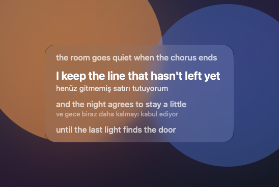

# Verseglass

[English](README.md) · [Türkçe](docs/tr/README.md)

A menu-bar lyric card for macOS. It sits above other apps, shows the line being sung in white, the previous line faded above it, and the next lines faded below. Drag the card anywhere. There is no Dock icon and no account to sign in to.

Spotify and YouTube or YouTube Music playing in a browser are supported. Lyrics come from [LRCLIB](https://lrclib.net), which is free and needs no key. When the Mac already has an on-device translation language, each line can show a translation underneath.



Requires **macOS 15 or later**, on Apple Silicon or Intel. macOS 14 and earlier are not supported. No Apple Developer membership.

Download [Verseglass-macOS.zip](https://github.com/emre-cil/verseglass/releases/latest/download/Verseglass-macOS.zip), unzip it, and double-click `Install.command`. The app is copied to `/Applications` and set to open at login. It does not appear in the Dock. Look for the music-note icon on the right side of the menu bar, or open Verseglass from Spotlight.

To build and install from a clone:

```bash
git clone https://github.com/emre-cil/verseglass.git
cd verseglass
./install.sh
```

`./install.sh` builds one universal app, copies it to `/Applications`, and turns on Open at login. `./build.sh` only writes `dist/Verseglass.app` and `dist/Verseglass-macOS.zip`.

## Card

- The sung line is white.
- The previous line is dim and sits above it.
- The following lines are dim and sit below it.
- Drag the card to move it. The position is remembered.
- The menu-bar note opens offset, hide, and quit.

## Guides

- [Install](docs/install.md)
- [Permissions](docs/permissions.md)
- [Players](docs/players.md)
- [Lyrics](docs/lyrics.md)
- [Translation](docs/translation.md)
- [Troubleshooting](docs/troubleshooting.md)

## License

[MIT](LICENSE)
