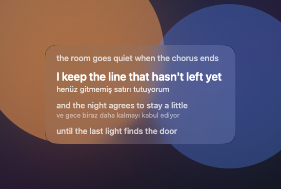

# Verseglass

[English](../../README.md) · [Türkçe](README.md)

macOS için menü çubuğu söz kartı. Diğer uygulamaların üstünde durur. Söylenen satır beyazdır; bir önceki satır onun üstünde soluk, sonrakiler altında soluktur. Kartı istediğin yere sürükle. Dock ikonu ve hesap yoktur.

Spotify ile tarayıcıdaki YouTube veya YouTube Music desteklenir. Sözler ücretsiz [LRCLIB](https://lrclib.net) kaynağından gelir, anahtar gerekmez. Mac’te cihaz içi çeviri dili yüklüyse her satırın altında çeviri görünebilir.



**macOS 15** ve sonrası gerekir; Apple Silicon ve Intel. macOS 14 ve öncesi desteklenmez. Ücretli Apple Developer üyeliği gerekmez.

[Verseglass-macOS.zip](https://github.com/emre-cil/verseglass/releases/latest/download/Verseglass-macOS.zip) dosyasını indir, aç, `Install.command` dosyasına çift tıkla. Uygulama `/Applications` içine kopyalanır ve açılışta başlar. Dock’ta görünmez. Menü çubuğunun sağındaki nota simgesine bak, ya da Spotlight’tan Verseglass yaz.

Klonlayıp derleyerek kurmak için:

```bash
git clone https://github.com/emre-cil/verseglass.git
cd verseglass
./install.sh
```

`./install.sh` tek bir evrensel uygulama derler, `/Applications` içine kopyalar ve Açılışta başlat’ı açar. `./build.sh` yalnızca `dist/Verseglass.app` ve `dist/Verseglass-macOS.zip` yazar.

## Kart

- Söylenen satır beyazdır.
- Önceki satır soluktur ve üstte durur.
- Sonraki satırlar soluktur ve altta durur.
- Kartı sürükleyince yeri hatırlanır.
- Menü çubuğundaki nota; kaydırma, gizleme ve çıkışı açar.

## Rehberler

- [Kurulum](install.md)
- [İzinler](permissions.md)
- [Oynatıcılar](players.md)
- [Sözler](lyrics.md)
- [Çeviri](translation.md)
- [Sorun giderme](troubleshooting.md)

## Lisans

[MIT](../../LICENSE)
